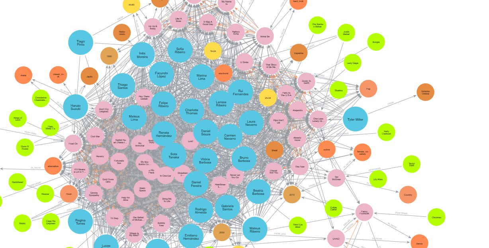
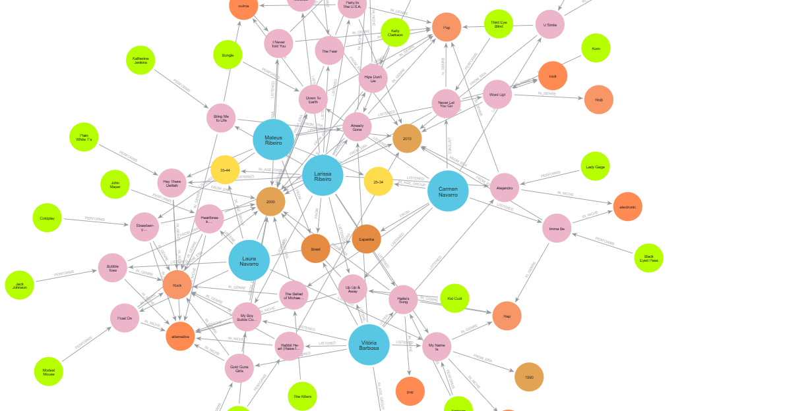
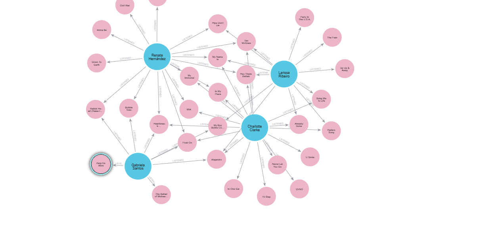
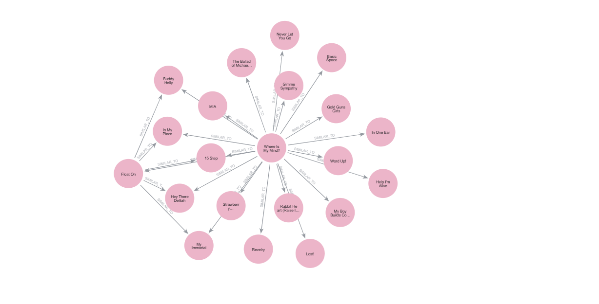

# Modelagem de Dados em Grafos de um Serviço de Streaming

Sistema de recomendação musical desenvolvido com Python e Neo4j, utilizando bancos de dados em grafo para representar relações entre músicas, artistas, gêneros musicais, épocas, nichos e usuários.

O projeto explora como as conexões entre os dados e o histórico de reprodução podem ser utilizadas para identificar similaridades e gerar recomendações musicais personalizadas.

## Objetivos

- Modelar um sistema de recomendação musical utilizando Neo4j.
- Representar relacionamentos entre usuários, músicas e características musicais.
- Identificar músicas semelhantes com base em seus atributos.
- Gerar recomendações considerando características musicais e histórico de reprodução.
- Explorar consultas Cypher para análise e visualização dos dados.

## Tecnologias utilizadas

- Python
- Neo4j
- Cypher
- Pandas
- CSV

## Fonte dos dados

O conjunto de dados musicais foi obtido no Kaggle:

[Million Song Dataset - Spotify/Last.fm](https://www.kaggle.com/datasets/undefinenull/million-song-dataset-spotify-lastfm)

Os dados de usuários foram criados para simular históricos de reprodução e permitir a análise das recomendações.

## Modelo do grafo

O banco de dados utiliza seis tipos de nós principais:

| Nó | Descrição |
|---|---|
| `User` | Usuários do sistema |
| `Song` | Músicas do catálogo |
| `Artist` | Artistas |
| `Genre` | Gêneros musicais |
| `Era` | Décadas ou épocas musicais |
| `Niche` | Nichos musicais |

### Relacionamentos

| Relacionamento | Descrição |
|---|---|
| `PERFORMS` | Relaciona artistas às músicas |
| `IN_GENRE` | Relaciona músicas aos gêneros |
| `FROM_ERA` | Relaciona músicas às épocas |
| `IN_NICHE` | Relaciona músicas aos nichos |
| `LISTENED` | Registra as músicas ouvidas pelos usuários e a quantidade de reproduções |
| `SIMILAR_TO` | Representa a similaridade entre músicas |
| `RECOMMENDED` | Registra as recomendações geradas para os usuários |

## Lógica de recomendação

A pontuação das recomendações combina características compartilhadas entre as músicas, considerando gêneros, nichos, épocas e similaridade entre tags.

A fórmula utilizada é:

```text
score = gêneros em comum * 3
      + nichos em comum * 2
      + épocas em comum * 1
      + similaridade por tags * 5
```

Os pesos atribuem diferentes níveis de importância a cada característica durante a classificação das músicas recomendadas.

## Estrutura dos dados

### `musicas_50.csv`

Contém informações sobre as músicas utilizadas no projeto.

| Campo | Descrição |
|---|---|
| `song_id` | Identificador da música |
| `title` | Título da música |
| `year` | Ano de lançamento |
| `tags` | Tags associadas à música |
| `artist` | Artista |
| `genre` | Gênero musical |
| `decade` | Década |
| `niche` | Nicho musical |

### `usuarios.csv`

Contém os dados dos usuários simulados.

| Campo | Descrição |
|---|---|
| `user_id` | Identificador do usuário |
| `nome` | Nome |
| `idade` | Idade |
| `nacionalidade` | Nacionalidade |
| `faixa_etaria` | Faixa etária |

### `listened.csv`

Registra o histórico de reprodução dos usuários.

| Campo | Descrição |
|---|---|
| `user_id` | Identificador do usuário |
| `song_id` | Identificador da música |
| `vezes` | Quantidade de reproduções |

## Visualizações do grafo

As visualizações permitem explorar as conexões entre os usuários, as músicas e suas características.

### Modelo geral do grafo



### Modelo com cinco usuários



A visualização com cinco usuários facilita a compreensão das relações entre os nós. Ao reduzir a quantidade de elementos, as conexões ficam mais claras e a análise se torna menos poluída visualmente.

### Histórico de reprodução



### Similaridade entre músicas



## Resultados das recomendações

O arquivo `docs/recommend.json` contém os dados das tabelas de recomendação geradas pelo projeto.

Esses resultados permitem consultar as músicas recomendadas e analisar as pontuações atribuídas pelo sistema.

## Consultas Cypher

O arquivo `consultas.txt` reúne consultas utilizadas para explorar o banco de dados, analisar os relacionamentos, visualizar o grafo e consultar as recomendações.

## Uso de inteligência artificial

Ferramentas de inteligência artificial foram utilizadas como apoio durante o desenvolvimento, incluindo a elaboração de consultas Cypher, integração entre Python e Neo4j, depuração de erros, construção da lógica de recomendação e documentação.

Os dados de usuários foram simulados com auxílio do Claude.

## Possíveis melhorias

- Aprimorar os critérios de similaridade musical.
- Incorporar novas características das músicas.
- Avaliar a qualidade das recomendações com métricas específicas.
- Desenvolver uma interface para explorar as recomendações.
- Ampliar o conjunto de dados e os cenários de análise.

